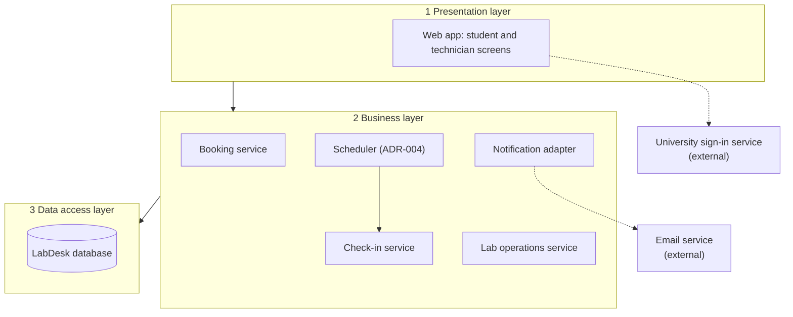

# Architecture: LabDesk

> Worked example for teaching (LabDesk). Not a student submission and not a real product.

Lesson 4 (Prof. Seki, architectural design). The steps follow the design process of the lecture:
stakeholder requirements, system requirements, functional design, physical design, three layers.
Decisions are recorded as ADRs in [`adr/`](adr/).

| Field | Value |
|---|---|
| Version | v2 |
| Inputs | [CVCA](../context/cvca.md) (stakeholder requirements), [Context Diagram](../context/context-diagram.md), [Use Case Diagram](../use-case/use-case-diagram.md) |

## 1. System requirements

| ID | System requirement | From |
|---|---|---|
| SyR-01 | The system shall let a student reserve one free seat in a lab time slot. | StR-01 |
| SyR-02 | The system shall let a student cancel a booking before its slot starts. | StR-02 |
| SyR-03 | The system shall record a student's presence at the start of a slot. | StR-03 |
| SyR-04 | The system shall free the seats of students who did not check in, and limit repeated no-shows. | StR-03 |
| SyR-05 | The system shall let a Lab Technician block and unblock a seat. | StR-04 |
| SyR-06 | The system shall show and report the occupancy of each lab. | StR-05 |

The detailed, testable version of each requirement is an EARS row in
[W1](../function-list/w1-function-list.md).

## 2. Functional design

The system requirements divided into subordinate functions.

| Function | Serves |
|---|---|
| Identify the user and the role | all |
| List slots and seat states | SyR-01 |
| Save, cancel and list bookings | SyR-01, SyR-02 |
| Record check-in | SyR-03 |
| Release no-shows on time and count them | SyR-04 |
| Block and unblock seats | SyR-05 |
| Compute occupancy and the monthly report | SyR-06 |
| Send notifications | SyR-01, SyR-04, SyR-05 |

## 3. Physical design

Each function allocated to an element of the system.

Solid arrows run from layer to layer; dotted arrows go to external systems. Inside the business
layer, the Scheduler starts the Check-in service, and every service sends messages through the
Notification adapter.

| Function | Element | Layer |
|---|---|---|
| Identify the user and the role | Web app with University sign-in service (ADR-002) | Presentation, external |
| List slots and seat states | Booking service | Business |
| Save, cancel and list bookings | Booking service | Business |
| Record check-in | Check-in service | Business |
| Release no-shows on time and count them | Scheduler starts Check-in service (ADR-004) | Business |
| Block and unblock seats | Lab operations service | Business |
| Compute occupancy and the monthly report | Lab operations service | Business |
| Send notifications | Notification adapter with Email service (ADR-003) | Business, external |
| Keep labs, seats, slots, bookings, booking rights | LabDesk database | Data access |

All screens of Lesson 8 are elements of the presentation layer. Their data sources are the data
groups of W0 Table 4.

## 4. Decisions

| ADR | Decision | Status |
|---|---|---|
| [ADR-001](adr/ADR-001-one-web-app.md) | One responsive web app for students and technicians, no native app | Accepted |
| [ADR-002](adr/ADR-002-university-sign-in.md) | Sign in with the university account; LabDesk keeps no passwords | Accepted |
| [ADR-003](adr/ADR-003-email-service.md) | Send all email through an external email service | Accepted |
| [ADR-004](adr/ADR-004-scheduler.md) | Add a scheduler for timed jobs | Accepted (after Lesson 7) |

## Change log

| Version | When | Change | Why |
|---|---|---|---|
| v1 | Lesson 4 | Web app, Booking service, Check-in service, Lab operations service, Notification adapter, database | |
| v2 | Lesson 7 | Added Scheduler | AD-UC-05 showed a job that must start by itself 15 minutes after each slot starts (ADR-004; Inputs check row 3 in [activity-index](../activity/activity-index.md)) |
