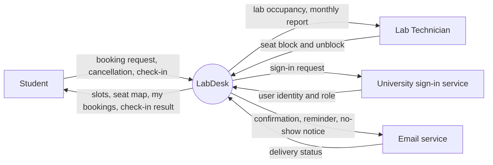

# Context Diagram: LabDesk

> Worked example for teaching (LabDesk). Not a student submission and not a real product.

Lesson 3. LabDesk is one black box in the middle; around it are the external entities it
exchanges data with. The Context Diagram answers "what does the system interact with?"; the
[Use Case Diagram](../use-case/use-case-diagram.md) answers "who wants the system to do what?".

| Field | Value |
|---|---|
| Version | v2 |
| Built from | [CVCA](cvca.md): every stakeholder that exchanges information with LabDesk |

## Diagram

Time is not an external entity: timed behaviour (releasing no-show seats) is shown as a use case
started by time in the Use Case Diagram.

## Data crossing the boundary

These are the data groups of W0 Table 4 in [the function list](../function-list/w0-scope.md).

| Data group | Kept by | Reaches LabDesk from |
|---|---|---|
| Labs, seats and time slots | LabDesk | Lab Technician |
| Bookings | LabDesk | Student |
| Booking rights | LabDesk | LabDesk itself (no-show rule) |
| University accounts | University sign-in service (read only) | University sign-in service |

## Change log

| Version | When | Change | Why |
|---|---|---|---|
| v1 | Lesson 3 | First version: Student, Lab Technician, University sign-in service | |
| v2 | Lesson 7 | Added Email service | The sequence for UC-01 sent confirmation emails, but the entity was missing here (Inputs check, row 2, in [activity-index](../activity/activity-index.md)) |
