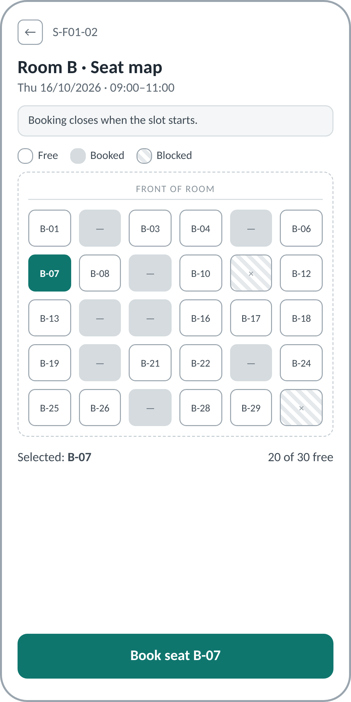

# Screen Spec: S-F01-02 Seat map (WORKED EXAMPLE)

> Worked example for teaching (LabDesk). Not a student submission and not a real product.

| Field | Value |
|---|---|
| Screen ID | S-F01-02 |
| Screen name | Seat map |
| Actor | Student |
| Priority | Must |
| Feature | F-01 Seat Booking |
| Activity diagrams | AD-UC-01 (actions "Choose a seat", "Confirm the seat", "See booking confirmed") |
| Mockup image | `img/S-F01-02.png` |
| Status | Reviewed |

## 1. Purpose

**Shown when:** the student has picked a lab and a time slot on S-F01-01 and now chooses a seat.

**The user leaves this screen when:** the booking is saved (success state, then "View my bookings"
or "Book another seat"), or the student goes back to change the slot.

## 2. Mockup

## 3. Element inventory

| # | Element | Type | Content / data source | Required | Validation |
|---|---|---|---|---|---|
| 1 | Back | Button | static | Yes | none |
| 2 | Title | Header | `lab.room_name` + "Seat map" | Yes | |
| 3 | Slot line | Text | `slot.date`, `slot.start_time`–`slot.end_time` | Yes | formats from ui-conventions |
| 4 | Closing banner | Banner | static: "Booking closes when the slot starts." (BR-02) | Yes | |
| 5 | Legend | Text | static: Free, Booked, Blocked | Yes | |
| 6 | Seat grid | List of seat tiles | `seat.code`, `seat.state` for the slot (FR-01-02) | Yes | one tile per seat of the lab |
| 7 | Seat tile | Toggle | selectable only when `seat.state` = Free (BR-03) | Yes | one seat selected at most |
| 8 | Selected summary | Text | selected `seat.code`; count of Free seats | Yes | "none" when nothing is selected |
| 9 | Book seat | Primary button | label "Book seat <code>" | Yes | disabled until a seat is selected |
| 10 | Message area | Banner | error or info messages (FR-01-04, FR-01-05) | No | |

## 4. States

| State | What the user sees | Trigger |
|---|---|---|
| Default | Seat grid with free, booked and blocked seats; Book seat disabled until a seat is selected. The mockup shows this state with B-07 selected. | Screen opened, seats loaded |
| Empty (no data) | "No free seats in this slot." with link "Choose another slot"; no grid | Every seat is booked or blocked |
| Loading | Grid of grey placeholders; Book seat disabled | Seats are being fetched |
| Error | Orange message "Seat B-07 was just booked by someone else...", grid refreshed, selection cleared (FR-01-04). Second error: "You already have seat B-03 in this slot." with link to S-F01-03 (FR-01-05). Network failure: "Not saved yet. Check your connection and try again.", selection kept | Save rejected, or the request failed |
| Success / confirmation | Check mark, "Seat booked", booking card with seat, room, date, slot, check-in window and email note; buttons "View my bookings" and "Book another seat" | Booking saved with status Confirmed (FR-01-03) |

## 5. Interactions and navigation

| # | Element | User action | System response | Goes to screen |
|---|---|---|---|---|
| 1 | Seat tile (Free) | tap | Selects the seat; summary and button label update | stays |
| 2 | Seat tile (Booked or Blocked) | tap | Nothing; tile is not selectable | stays |
| 3 | Book seat | tap | Saves the booking (FR-01-03) or shows the matching error state | stays (success or error state) |
| 4 | View my bookings | tap (success state) | Opens the booking list | S-F01-03 |
| 5 | Book another seat | tap (success state) | Returns to the slot list | S-F01-01 |
| 6 | Back | tap | Returns without saving | S-F01-01 |
| 7 | Link in "already booked" message | tap | Opens the existing booking | S-F01-03 |

## 6. Screen-level rules

| Rule ID | Rule | Source |
|---|---|---|
| SR-001 | Only Free seats can be selected; at most one seat at a time. | BR-03 |
| SR-002 | The seat state shown is never trusted at save time: the save re-checks it. | FR-01-04 |
| SR-003 | After the slot start time the screen shows "Booking for this slot has closed" and disables Book seat. | BR-02 |
| SR-004 | Seat states differ by fill and by symbol, never by colour alone. | ui-conventions §5 |

## 7. Linked requirements

| FR ID | What this screen does for it |
|---|---|
| FR-01-02 | Displays the seat map with free, booked and blocked seats |
| FR-01-03 | Provides the Book seat action and the success state |
| FR-01-04 | Shows the "seat was just taken" error and refreshes the map |
| FR-01-05 | Shows the "already booked in this slot" error with a link to the booking |

## 8. Responsive and accessibility notes

- Smallest supported width: 360px; the grid keeps 6 columns and tiles shrink to no less than 24px.
- On wider screens the summary and button move to a right-hand panel.
- Seat states use fill plus symbol: code for free, a dash for booked, a cross for blocked.
- Body text contrast at least 4.5:1.

## 9. Open questions

| # | Question | Blocking? | Status |
|---|---|---|---|
| 1 | [NEEDS CLARIFICATION: should the seat map refresh by itself while the student is looking at it?] | No | Open. Default: refresh only on save or on re-open. |

---

## Completion checklist

- [x] The mockup is a separate cropped image file, named with the Screen ID.
- [x] Every visible element in the mockup appears in the element inventory.
- [x] Every input element has a validation rule or an explicit "none".
- [x] All five states are filled in.
- [x] Every navigation target is a Screen ID that exists in the Screen List.
- [x] Every element that displays data names the field it displays.
- [x] Every linked FR exists in the Function List, and every action of this screen in AD-UC-01 is
      covered by an interaction row.
