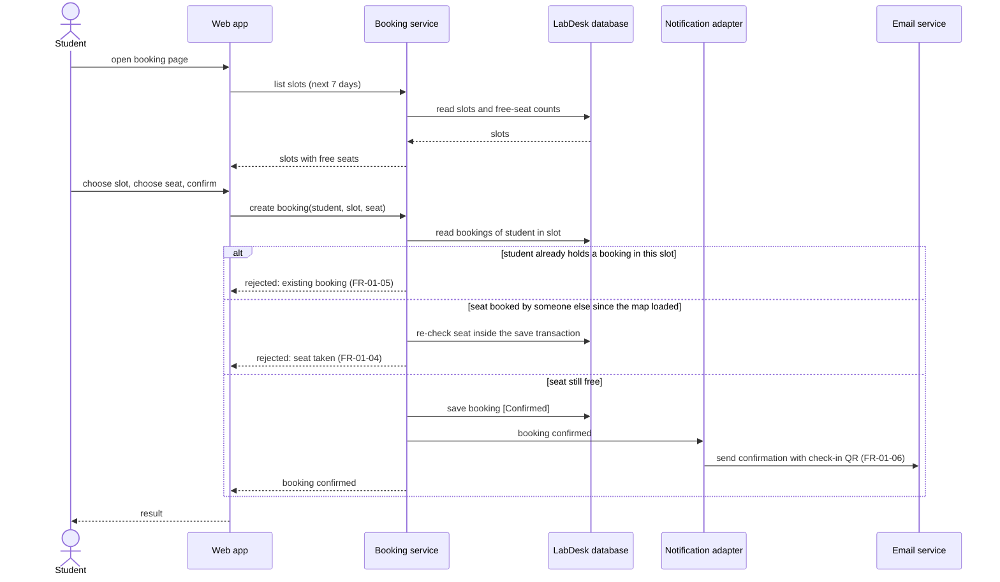

# Sequence Diagram: SD-UC-01 Reserve a seat

> Worked example for teaching (LabDesk). Not a student submission and not a real product.

Lesson 4, analysis level: how the parts of LabDesk talk to each other when a student reserves a
seat. The lifelines are the elements of the [physical design](../architecture/architecture.md).
The student's choices (which slot, which seat) are shown in the activity diagram
[AD-UC-01](../activity/AD-UC-01.md), not here.

| Field | Value |
|---|---|
| Use case | UC-01 Reserve a seat |
| Version | v2 (split from "Booking flow", which told UC-01 and UC-02 together) |
| FRs | FR-01-01 to FR-01-06 |

The `alt` fragments here are outcomes decided inside the system, so they belong in a sequence
diagram. A choice the student makes would be a decision in the activity diagram instead.
