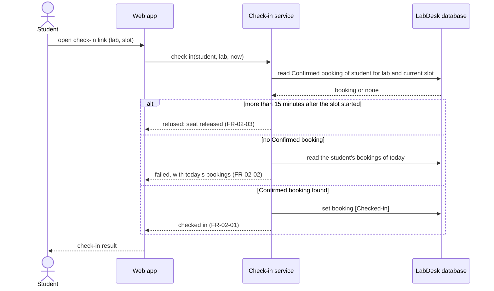

# Sequence Diagram: SD-UC-04 Check in at the lab

> Worked example for teaching (LabDesk). Not a student submission and not a real product.

Lesson 4, analysis level. The student scans the QR code on the lab door with the phone camera; the
link opens LabDesk in the phone browser.

| Field | Value |
|---|---|
| Use case | UC-04 Check in at the lab |
| Version | v1 |
| FRs | FR-02-01, FR-02-02, FR-02-03 |

