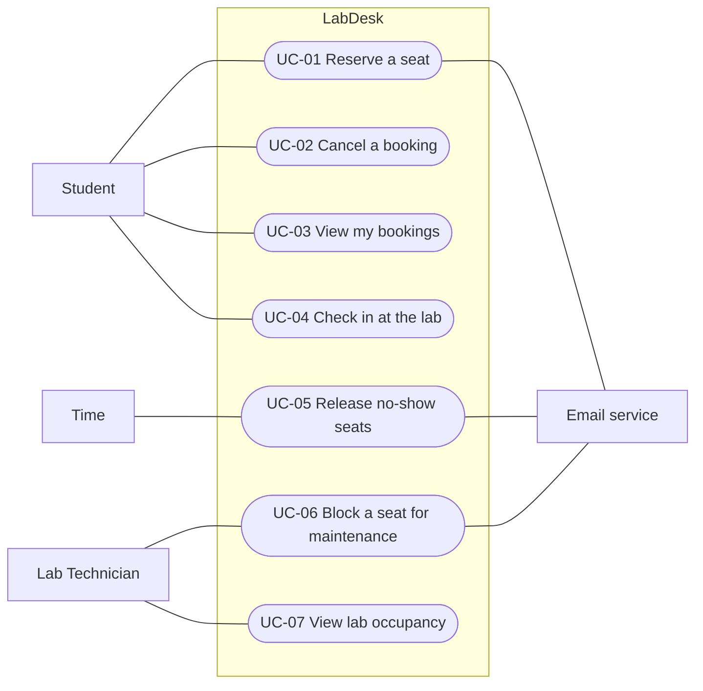

# Use Case Diagram: LabDesk

> Worked example for teaching (LabDesk). Not a student submission and not a real product.

Lesson 4 (Prof. Seki). Who wants LabDesk to do what. Mermaid has no use case diagram type, so the
diagram below is drawn as a flowchart: people on the outside, use cases (rounded) inside the
system boundary. In a drawing tool use the UML notation (stick figures, ovals).

| Field | Value |
|---|---|
| Version | v2 |
| Actors | Student, Lab Technician (primary); Time (starts UC-05); Email service (secondary) |

## Diagram

The full use case inventory, with features and login rules, is W0 Table 1 in
[w0-scope.md](../function-list/w0-scope.md).

## Sequence diagrams

One sequence diagram per use case, at analysis level: the lifelines are the elements of the
[physical design](../architecture/architecture.md).

| Use case | Sequence diagram | Status |
|---|---|---|
| UC-01 Reserve a seat | [SD-UC-01](SD-UC-01.md) | Done (split from "Booking flow" after Lesson 7) |
| UC-02 Cancel a booking | SD-UC-02 | Open: still to be drawn (Inputs check row 4, Owner A) |
| UC-04 Check in at the lab | [SD-UC-04](SD-UC-04.md) | Done |
| UC-03, UC-05, UC-06, UC-07 | (not drawn in this example) | Students practise on these |

## Change log

| Version | When | Change | Why |
|---|---|---|---|
| v1 | Lesson 4 | Six use cases, actors Student and Lab Technician | |
| v2 | Lesson 7 | Added UC-05 Release no-show seats, started by Time | No use case covered releasing unused seats (Inputs check, row 1, in [activity-index](../activity/activity-index.md)) |
